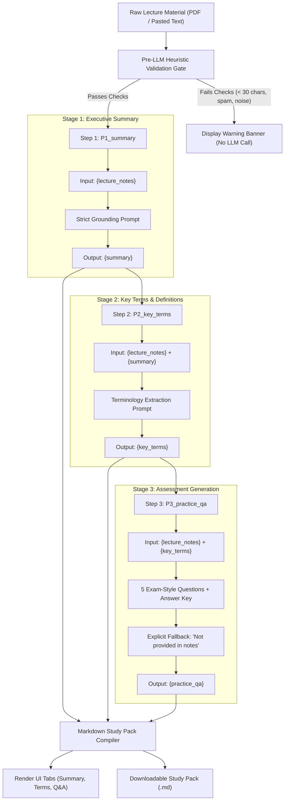
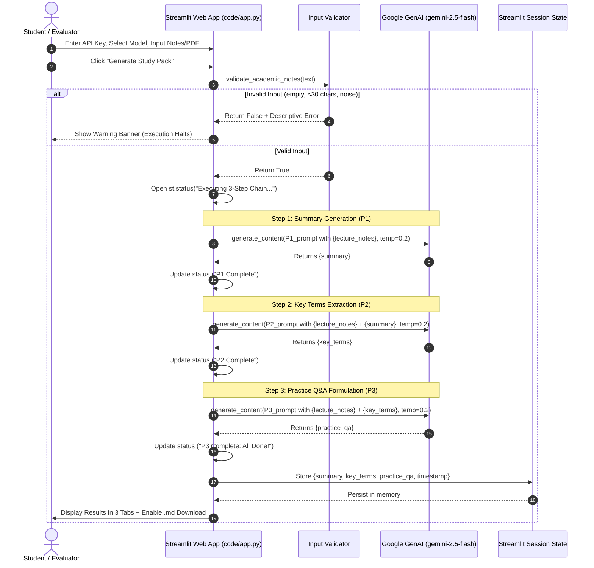
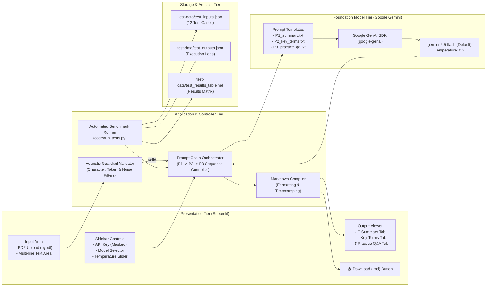

# 📐 Architecture & Workflow Diagrams
**Project:** AI-Powered Study Pack Generator Using Prompt Engineering  
**Course Code:** SCSE4041 | **Milestone 2**  
**Team:** PE-B25-45 (Visionaries)

---

## 1. 🔄 Sequential Prompt Workflow

This diagram illustrates the 3-step sequential prompt chain (`P1` → `P2` → `P3`), highlighting how context and intermediate outputs are conditioned and passed between steps.

---

## 2. 🧩 Task Decomposition Hierarchy

This diagram decomposes the high-level study pack generation problem into discrete, testable sub-tasks, comparing the monolithic Milestone 1 approach with our chained Milestone 2 architecture.

```mermaid
flowchart TB
    Root["AI-Powered Study Pack Generation"]
    
    subgraph Ingestion["1. Ingestion & Pre-processing"]
        Root --> T1["Text Ingestion Layer"]
        T1 --> T1A["PDF Byte Parser (pypdf)"]
        T1 --> T1B["Raw Text Editor Input"]
        T1 --> T1C["Heuristic Guardrail Validator"]
    end
    
    subgraph Chaining["2. Prompt Chaining Engine"]
        Root --> T2["Sequential Prompt Execution"]
        T2 --> T2A["Task 1: Thematic Summarization (P1)"]
        T2 --> T2B["Task 2: Academic Term Extraction (P2)"]
        T2 --> T2C["Task 3: Exam Q&A Construction (P3)"]
    end
    
    subgraph Guardrails["3. Strict Grounding Constraints"]
        Root --> T3["Anti-Hallucination Policies"]
        T3 --> T3A["Zero Outside Extrapolation Rule"]
        T3 --> T3B["Bounded Term Scope Rule"]
        T3 --> T3C["Missing Fact Sentinel: 'Not provided in notes'"]
    end
    
    subgraph Delivery["4. Output Presentation & Export"]
        Root --> T4["User Presentation Layer"]
        T4 --> T4A["Real-time Execution Status Tracker"]
        T4 --> T4B["Responsive Multi-Tab Display"]
        T4 --> T4C["Single-Click Markdown Exporter"]
    end
```

---

## 3. 🔁 End-to-End Input-Output Flow

This sequence diagram depicts the chronological message exchange between the Student, the Streamlit UI, the Validation Engine, and the Google Gemini API.

---

## 4. 🏛️ System Architecture

This diagram illustrates the multi-tier architectural layers of the application, showing clean separation of concerns between presentation, orchestration, model integration, and evaluation.

